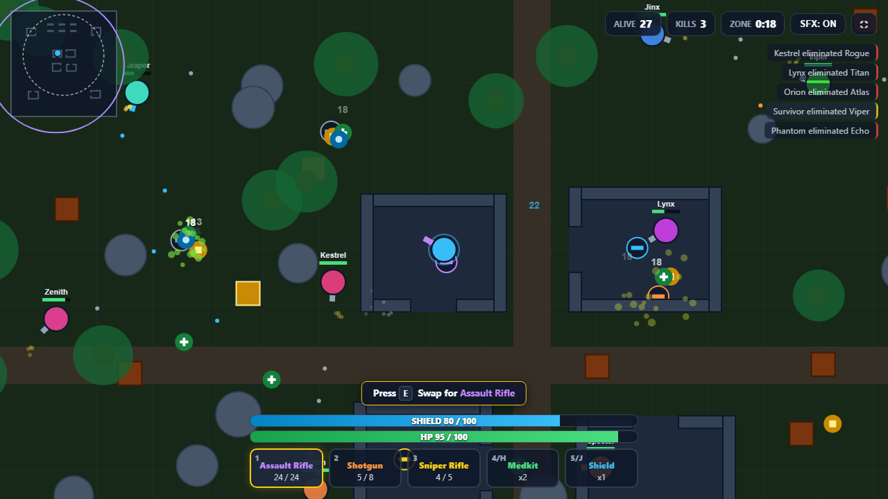
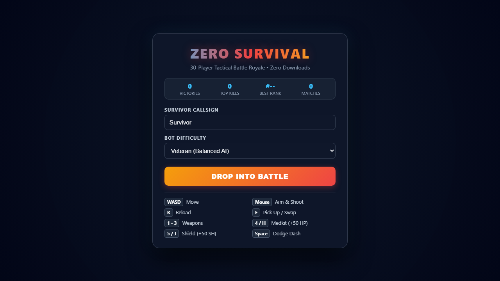
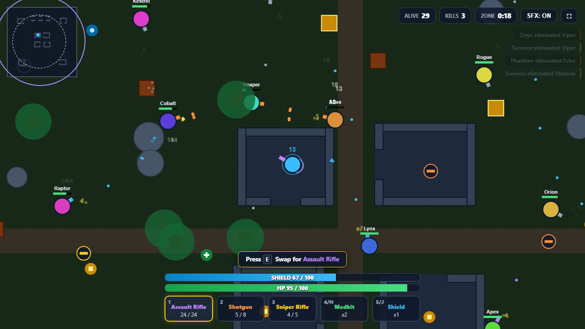
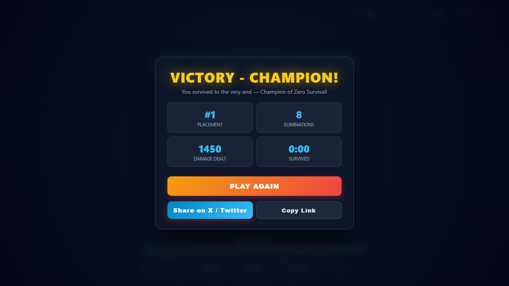

<div align="center">

# ⚡ ZERO SURVIVAL

### *30-Player Tactical Browser Survival Arena — Zero Downloads, Instant Action*

[](https://ranajawadai.github.io/zero-survival/)
[](https://github.com/ranajawadai/zero-survival/stargazers)
[](LICENSE)
[](index.html)

**[🎮 CLICK HERE TO PLAY LIVE IN BROWSER](https://ranajawadai.github.io/zero-survival/)**

---

<p align="center">
  
</p>

</div>

## 📖 About Zero Survival

**Zero Survival** is a high-octane, top-down 2D multiplayer-style survival shooter designed to run natively in any modern browser with **zero dependencies, zero external assets, and zero downloads**. 

Drop into a vast 2400×2400 tactical map alongside **29 adaptive AI combatants**. Scavenge military outposts and supply crates for high-tier weaponry, manage shields and medical supplies, outmaneuver opponents with evasive dodge-dashes, and race against an ever-shrinking radioactive storm circle to become the **Ultimate Lone Survivor**!

---

## 📸 Gameplay Showcase

<table align="center" width="100%">
  <tr>
    <td width="50%" align="center">
      <b>🎯 Drop-In Screen & Difficulty Select</b><br/><br/>
      
    </td>
    <td width="50%" align="center">
      <b>⚔️ Tactical Firefights & Cover</b><br/><br/>
      
    </td>
  </tr>
  <tr>
    <td width="50%" align="center">
      <b>🗺️ Safe Zone Radar & Storm Perimeter</b><br/><br/>
      
    </td>
    <td width="50%" align="center">
      <b>🏆 Victory & Career Stats Breakdown</b><br/><br/>
      
    </td>
  </tr>
</table>

---

## 🎮 Controls

### Desktop (Keyboard & Mouse)

| Action | Key / Input |
|---|---|
| **Move** | <kbd>W</kbd> <kbd>A</kbd> <kbd>S</kbd> <kbd>D</kbd> or Arrow Keys |
| **Aim & Shoot** | <kbd>Mouse Cursor</kbd> + <kbd>Left Click</kbd> |
| **Dodge Dash** | <kbd>Spacebar</kbd> *(Burst speed with cooldown)* |
| **Reload Weapon** | <kbd>R</kbd> |
| **Pick Up / Swap Loot** | <kbd>E</kbd> or <kbd>F</kbd> |
| **Switch Weapons** | <kbd>1</kbd> <kbd>2</kbd> <kbd>3</kbd> or Click Weapon Slot |
| **Use First Aid Medkit** | <kbd>4</kbd> or <kbd>H</kbd> *(Restores +50 HP)* |
| **Use Shield Battery** | <kbd>5</kbd> or <kbd>J</kbd> *(Restores +50 Shield)* |
| **Toggle Fullscreen** | Click <kbd>⛶</kbd> button on HUD |
| **Toggle Audio SFX** | Click <kbd>SFX: ON/OFF</kbd> button |

### Mobile & Tablet

* **Movement**: Adaptive floating on-screen joystick on the bottom-left.
* **Actions**: Dedicated touch buttons for **FIRE**, **DASH**, **RELOAD**, and **SWAP** on the bottom-right.
* **Auto-aim / Facing**: Turn towards touch movement vectors seamlessly.

---

## 🔫 Weapons & Arsenal

Every firearm in **Zero Survival** features distinct handling, projectile physics, spread parameters, and sound profiles:

| Weapon | Class | Damage | Fire Rate | Mag Size | Range | Ammo Type | Role / Playstyle |
|:---|:---:|:---:|:---:|:---:|:---:|:---:|:---|
| **Pistol** | Sidearm | 18 | Medium (270ms) | 12 | 640px | Light | Reliable starter pistol |
| **SMG** | Rapid Fire | 13 | Ultra-Fast (92ms) | 30 | 520px | Light | Devastating close-range shredder |
| **Shotgun** | Burst | 14 × 6 | Heavy (760ms) | 6 | 340px | Shells | One-shot lethal potential at point blank |
| **Assault Rifle** | Automatic | 22 | Fast (132ms) | 28 | 760px | Medium | The versatile all-rounder for mid-range |
| **Sniper Rifle** | Precision | 78 | Bolt-Action (1.2s) | 5 | 1150px | Heavy | High velocity, long-range eliminator |

---

## 🌟 Key Features

- **⚡ Zero Load Time**: Entire game is built in a single lightweight HTML5/JavaScript file with zero bloated external libraries.
- **🔊 Procedural Audio Engine**: Web Audio API oscillator synthesis produces dynamic gunfire, impacts, shield breaks, and dashes without downloading audio files.
- **🤖 Adaptive AI Bots**: 3 difficulty tiers (*Recruit*, *Veteran*, and *Apex Predator*) with pathfinding, cover-seeking, strafing, and retreat behaviors.
- **🌪️ 6-Phase Shrinking Storm**: Dynamic zone shrinking with visual storm aura and progressive periodic environmental damage.
- **📦 Destructible Map Props**: Break open wooden crates and rare golden chests to find medical supplies and high-tier gear.
- **🌳 Tactical Cover System**: Hide under tree canopies for foliage concealment and use stone bunkers and walls for line-of-sight defense.
- **📊 Career Tracking & Social Sharing**: Automatically records Victories, Matches, Top Kills, and Best Rank in `localStorage`. One-click sharing to X (Twitter) directly from the end screen.

---

## 🚀 Quick Start / Local Setup

No build tools or node packages required. Simply clone and open:

```bash
# Clone the repository
git clone https://github.com/ranajawadai/zero-survival.git

# Navigate into the folder
cd zero-survival

# Open directly in your browser
# On Windows:
start index.html

# On macOS:
open index.html

# On Linux:
xdg-open index.html
```

Or run a local development server:

```bash
npx serve .
# or
python -m http.server 8000
```

---

## 💡 Pro Survival Tips

1. **Prioritize Shields Early**: Your blue shield bar absorbs incoming damage first. Collect shield cells immediately from buildings and chests.
2. **Master the Dodge Dash**: Use <kbd>Space</kbd> to dodge incoming sniper rounds or shotgun blasts. It resets your momentum and evades bullets.
3. **Watch the Minimap Circle**: The dashed circle shows the next safe perimeter. Relocate early so you aren't caught fighting while taking storm damage.
4. **Listen for Nearby Shots**: Sound volume attenuates with distance. Use gun sound cues to locate skirmishes and third-party weakened survivors.
5. **Break Golden Chests**: Golden crates have higher durability but guarantee high-tier assault rifles or snipers plus shields!

---

## 🤝 Contributing

Contributions, bug reports, and feature suggestions are welcome!

1. Fork the Project (`https://github.com/ranajawadai/zero-survival/fork`)
2. Create your Feature Branch (`git checkout -b feature/NewWeapon`)
3. Commit your Changes (`git commit -m 'Add new weapon concept'`)
4. Push to the Branch (`git push origin feature/NewWeapon`)
5. Open a Pull Request

---

## 📄 License

Distributed under the **MIT License**. See [`LICENSE`](LICENSE) for more information.

---

<div align="center">

**Developed with ❤️ by [Rana Jawad](https://github.com/ranajawadai)**

*If you enjoyed playing Zero Survival, don't forget to give this repository a ⭐ star!*

</div>
